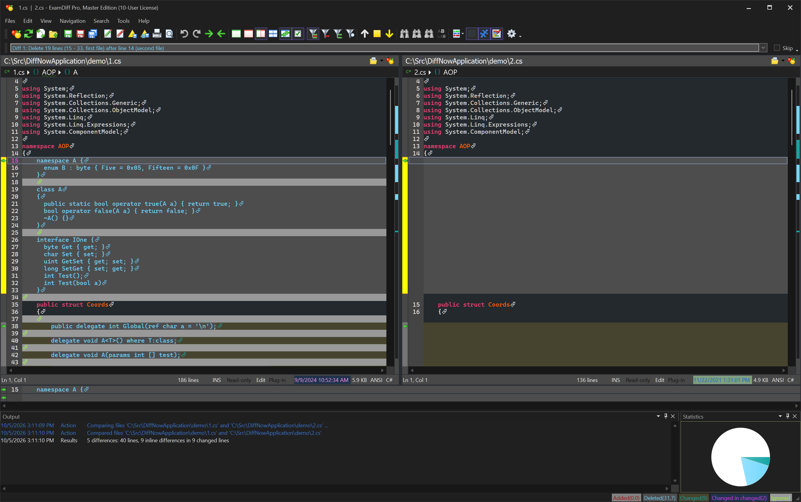
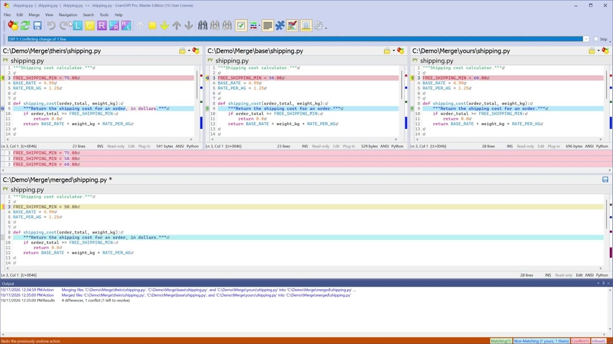

# ExamDiff Visual File Comparison Guide for Windows

Examdiff provides a focused way to inspect differences between two text files.
Examdiff Pro extends that workflow to directories, binary data, documents, and additional comparison modes.
If you searched for exam diff, examdiff online, or examdiff portable, the product distinctions below help identify the appropriate option.

PrestoSoft develops ExamDiff and ExamDiff Pro.
This independent guide also links selected WinMerge source files as comparison references.

[](https://examdiff.github.io/Examdiff-Pro/)

## What Can ExamDiff Do?

The freeware application presents two text files in synchronized panes.

Useful freeware tasks include:

- Reviewing changes between two saved configuration files.
- Checking a revised source file against an earlier copy.
- Ignoring selected whitespace or case differences.
- Repeating a comparison after either file changes.
- Exporting differences in UNIX diff format.

Choose the product and edition according to the operation you need.

| Review task | ExamDiff freeware | ExamDiff Pro |
| --- | --- | --- |
| Compare two text files | Supported | Supported |
| Navigate highlighted changes | Supported | Supported |
| Ignore whitespace and case | Supported | Supported |
| Compare directory trees | Not included | Supported |
| Compare binary files and Zip contents | Not included | Supported |
| Compare Office and PDF documents | Not included | Supported |
| Merge two or three file versions | Not included | Master Edition |
| Compare CSV data in table mode | Not included | Master Edition |

Check the [official edition comparison](https://www.prestosoft.com/edp_features.asp?ed=1) before choosing Standard or Master.
The trial exposes Master features, so a trial workflow may depend on a Master license afterward.



A comparison result reflects the active ignore settings.
Before deciding that two files match, confirm which differences the current session suppresses.

For source selection, the included WinMerge filters illustrate common review scopes:

- [SourceControl.flt](Filters/SourceControl.flt) excludes selected version control files and directories.
- [CSharp_loose.flt](Filters/CSharp_loose.flt) suppresses common generated binaries in C# projects.
- [XML_html.flt](Filters/XML_html.flt) selects web and XML development resources.

These definitions use WinMerge syntax.
They are reference examples rather than importable ExamDiff filter configurations.

## Requirements

ExamDiff and ExamDiff Pro are Windows applications.

The freeware application is available as files without an installer.
That package is the relevant option for a portable text comparison workflow.

DiffNow is the browser service powered by ExamDiff Pro.
Its browser workflow is separate from running the Windows executable.

| Option | Execution environment | Typical use |
| --- | --- | --- |
| ExamDiff freeware | Windows desktop | Compare two text files |
| ExamDiff Pro | Windows desktop | Compare folders and documents; merge with Master |
| DiffNow | Web browser | Compare pasted text or uploaded files online |

See the [freeware overview](https://www.prestosoft.com/edp_examdiff.asp) and [DiffNow](https://www.diffnow.com/) for their respective capabilities.

## Running

The freeware command line accepts two filenames followed by options.
The following PowerShell example requests the executable path rather than assuming an installation location.

Replace the sample review folder with an existing directory containing both files.

```powershell
$examDiffExe = Read-Host 'Full path to freeware ExamDiff.exe'
$reviewFolder = 'C:\Compare'
& $examDiffExe "$reviewFolder\baseline.txt" "$reviewFolder\candidate.txt" /n /!i /!w /!b /!l /!e
```

The /n option skips the initial file selection dialog.
The negated ignore options retain case and whitespace differences for this review.
Options not specified on the command line retain their previously used values.

After opening the comparison:

1. Confirm that the intended reference file is on the expected side.
2. Inspect the first changed block.
3. Move through the remaining differences.
4. Review any ignored categories before accepting an apparent match.
5. Export a diff when the review needs a separate record.

For Pro merge operations, use the documented Pro syntax and the appropriate edition.
The freeware command above does not enable editing or merging.

## Folder Structure

The source snapshot included here contains selected WinMerge components.
It supports inspection of themes, shell integration, and maintenance utilities.
It is not ExamDiff source code or a complete WinMerge checkout.

| Included area | What it illustrates |
| --- | --- |
| Color schemes | Stored appearance preferences |
| Shell extension | Windows context menus and integration |
| Filters | Rules for selecting comparison inputs |
| Maintenance scripts | Resource and translation checks |

Appearance references:

- [VS Dark.ini](ColorSchemes/VS%20Dark.ini) stores a dark WinMerge color scheme.
- [Default.ini](ColorSchemes/Default.ini) stores default syntax appearance settings.

Windows integration references:

- [WinMergeContextMenu.cpp](ShellExtension/Common/WinMergeContextMenu.cpp) implements comparison context menu behavior.
- [RegKey.cpp](ShellExtension/Common/RegKey.cpp) wraps Windows registry access.
- [AppxManifest.xml.in](ShellExtension/WinMergePkg/AppxManifest.xml.in) declares WinMerge package integration metadata.

Their contents do not establish how ExamDiff implements either concern.

## Developing

ExamDiff Pro can serve as an external Git comparison and merge tool.
Merging requires Master Edition functionality.

The following is an original Git configuration example.
It selects Git's ExamDiff merge tool integration, provides an executable path, and explicitly preserves merge backups.

```ini
[merge]
    tool = examdiff
[mergetool]
    keepBackup = true
[mergetool "examdiff"]
    path = "C:/Program Files/ExamDiff Pro/ExamDiff.exe"
```

Adjust the executable path to the actual Pro installation.
These are Git settings, not an ExamDiff preferences file.

Consult [PrestoSoft's integration guide](https://www.prestosoft.com/edp_versioncontrol.asp) and the [Git mergetool documentation](https://git-scm.com/docs/git-mergetool) for tool configuration and backup behavior.
Check the selected input panes and output file before saving a conflict resolution.

The reference snapshot also exposes language and string handling concerns:

- [LanguageSelect.cpp](ShellExtension/Common/LanguageSelect.cpp) implements shell extension language selection.
- [UnicodeString.cpp](ShellExtension/Common/UnicodeString.cpp) provides string utilities.
- [Version.in](Version.in) defines placeholders used in WinMerge version resources.

## Documentation

For directory comparison, decide whether the review concerns content, missing entries, or synchronization actions.
A timestamp difference by itself does not explain how file contents changed.

For Office and PDF comparison, inspect what the document conversion exposes.
Text differences and page layout differences answer different questions.



A reusable review note should identify:

- The two input locations.
- The selected product and edition.
- Active ignore and exclusion settings.
- The comparison method.
- Any merge or synchronization actions taken.
- The saved report or output location.

Use the [Pro online help](https://www.prestosoft.com/ps.asp?page=htmlhelp/edp/intro) for product-specific behavior.

## Contributing

Useful improvements to this independent guide include reproducible comparison cases and corrected documentation links.
Include the product edition, application version, Windows version, and relevant comparison settings.

The included WinMerge maintenance files illustrate checks used by another comparison project:

- [CheckUnusedResources.js](Tools/Scripts/CheckUnusedResources.js) identifies potentially unused resource identifiers.
- [CheckMenuResources.js](Tools/Scripts/CheckMenuResources.js) checks menu resources.
- [CheckTranslationStrings.ps1](Tools/Scripts/CheckTranslationStrings.ps1) compares extracted source strings with resources.
- [UpdateTranslations.bat](Tools/Scripts/UpdateTranslations.bat) coordinates translation update steps.
- [appveyor.yml](appveyor.yml) describes WinMerge build automation and packaged artifacts.

Some reference dependencies and source directories absent from this partial snapshot.

## Contact

Use PrestoSoft's official support channels for ExamDiff licensing and product questions.
For this guide, identify the paragraph or reference link that needs correction.

## Related Search Terms

Examdiff, Examdiff Pro, exam diff, examdiff online, examdiff portable, compare-files, diff, text-diff, merge, editor, git, windows, file-comparison, directory-comparison, synchronization
